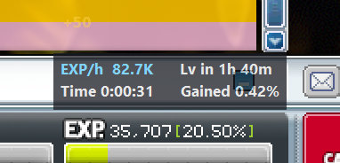
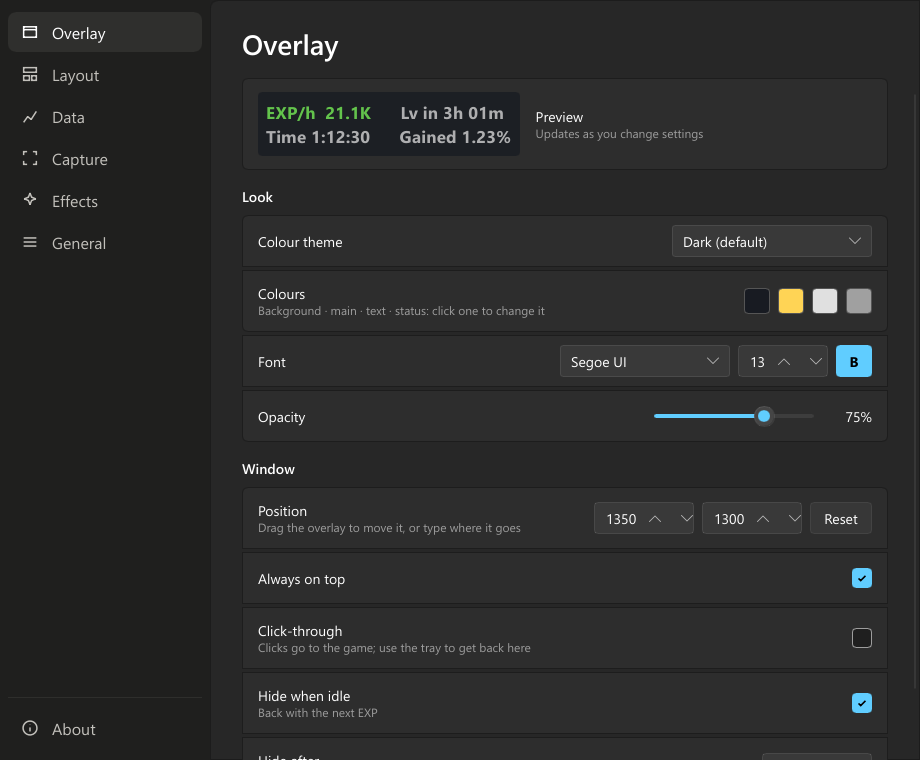
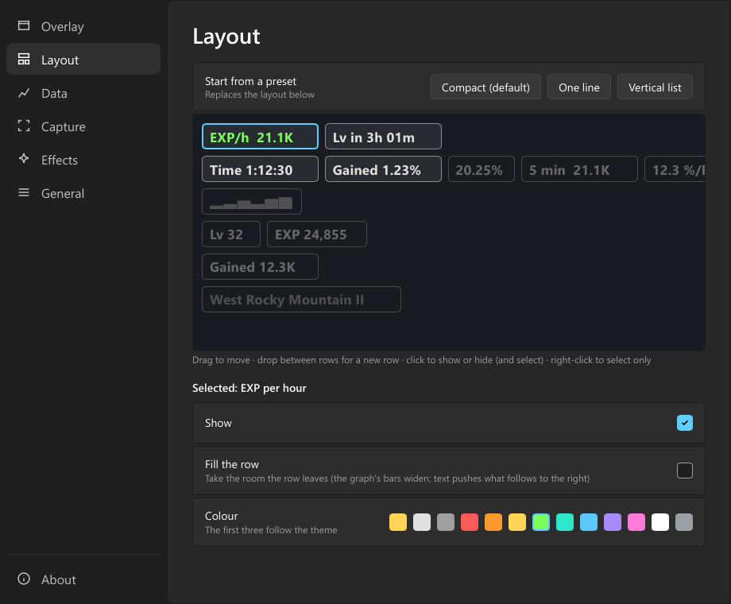

# Maple EXP Overlay

A tiny EXP/hr overlay for MapleStory Classic World. Rust, no runtime files; the EXP bar is read by matching digit shapes, no OCR engine. It only looks at your screen: it never touches the game's files or memory and never sends input.



> **Unofficial.** This is a fan-made tool. It is not made, endorsed or supported by Nexon and is not affiliated with Nexon. MapleStory is a trademark of Nexon. Using any third-party tool with an online game is at your own risk: read Nexon's Terms of Service, and if you are unsure whether a screen-reading tool is allowed, ask Nexon support. Nexon can act on an account at its own discretion.

## Install

1. Download the latest `maple-exp-overlay-<version>-windows-x64.zip` from the repository's Releases page.
2. Unzip it anywhere and run `maple-exp-overlay.exe`. Nothing is installed; to uninstall, quit it from the tray, delete the folder and `%APPDATA%\MapleExpOverlay`.

From 0.4.1 on, the app updates itself: when the settings window opens it looks for a new version (switch that off in **General**), downloads it and checks its signature, then shows **Relaunch to update** at the bottom of the sidebar. **About > Check for updates** does the same by hand. It installs only releases signed with this project's key.

The executable is not code-signed, so Windows SmartScreen may show "Windows protected your PC". Click "More info", then "Run anyway". To check the download, compare its SHA-256 with the `.sha256` file on the release page:

```
Get-FileHash .\maple-exp-overlay-<version>-windows-x64.zip -Algorithm SHA256
```

## Use it

1. Start the game (windowed or borderless fullscreen) with the EXP bar visible, then run `maple-exp-overlay.exe`. The settings window opens on the **Capture** page the first time.
2. Click **Select area...** and drag a box around the EXP text, for example `EXP. 24,855 [20.25%]`. Include the `EXP.` label and a little margin, and nothing else. Esc cancels.
3. Click **Test in game**, then switch to the game within 5 seconds and leave it in front. It says "Works" when the bar can be read, or tells you what to change. Test with the game in front: with the settings window in front, Windows can show the taskbar over the bar, which it normally hides while you play. If the taskbar or another window still covers the bar in game, set **Capture method** to **Game window** and test again.
4. Arrange what it shows on the **Layout** page: drag the pieces around, click one to show or hide it, and use the card under the editor for its colour and **Fill the row**. The **Overlay** page shows a preview of the result.
5. Optional, for the **Map** item: on **Capture**, click **Select map area...** and box both lines of the map name at the top of the minimap, with room for long names. Each new map is read once with the text recognition built into Windows and remembered.
6. Right-click the overlay (or use the tray icon) for **Settings...**, **Reset session**, **Hide overlay** and **Quit**. Drag the overlay to move it. **Quit** closes the settings window too.

The overlay reads nothing until an area is selected, and it never searches for the bar by itself. If you move or resize the game, or change its UI scale, select the area again.

Launching the exe again while it runs opens the settings.

## Settings





| Page | What's there |
|---|---|
| Overlay | A preview; colour theme and colours, font, size, bold, opacity; position, always on top, click-through, hide when idle. |
| Layout | Drag the pieces of data around to arrange the overlay (drop between rows for a new row). Click one to show or hide it and select it; the card below changes the selected one: show, fill the row, colour. Presets: Compact, One line, Vertical list. |
| Data | Short numbers, what time to level uses, the pause time, the "recent rate" length, new session after a break. |
| Capture | Test in game, the EXP bar area (Select area), the capture method (**Screen**, the default, reads what is on screen like any screen recorder; **Game window** reads the game's own picture, so the taskbar or a window on top can't hide the bar), how often it looks, and the optional map name area. |
| Effects | Rolling numbers, +EXP pop-up, snail, rainbow near level-up, and Preview effects. |
| General | Start with Windows, start hidden, tray icon, taskbar button, automatic update checks; open the settings folder, reset. |
| About | Version and updates, the unofficial notice, how the numbers are worked out, credits. |

When a new version has been downloaded and checked, **Relaunch to update** shows at the bottom of the sidebar on every page.

Settings live in `%APPDATA%\MapleExpOverlay\settings.json` (the settings window and the overlay are separate processes; the overlay reloads the file when it changes).

## How the numbers are worked out

The bar shows `EXP. 24,855 [20.25%]`. Every second the digits are matched against saved shapes (`src/digits.bin`, from the original project). A changed reading only counts when two looks in a row agree. EXP gained is the change between readings (a level-up counts the rest of the old bar plus the start of the new one). EXP/h = gained / time farmed x 3600, where time farmed leaves out stretches without EXP longer than the pause time. Time to level = percent left / percent per hour. When the game shows only the percentage, it works from that alone.

## Not working?

1. Use **Settings > Capture > Test in game** (or **Test now**): it says what it sees in your area and what to change.
2. "Text cut off" or "no brackets seen": the box is too small or something covers the bar. Select the area again, or switch **Capture method** to **Game window**.
3. A black capture: the game is in fullscreen-exclusive mode, which no tool can capture. Use borderless or windowed fullscreen.
4. The map name reads wrong or not at all: give the map area room for long names, and keep the region icon out of it if you can. HDR is fine (the map is read from a 16-bit capture).
5. Still stuck: run `maple-exp-overlay.exe --dump` and look at `dump.txt`, `dump-screen.bmp` and `dump-window.bmp` (and, with a map area, `dump-map-*.bmp`) in `%APPDATA%\MapleExpOverlay`.

## Build

```
cargo build --release
cargo test --release
```

Needs Rust 1.92 or newer and the Windows SDK (for the icon resource). If the linker can't open files, set `CARGO_TARGET_DIR` to a short path. CI (`.github/workflows/ci.yml`) enforces `cargo fmt --check`, `cargo clippy --all-targets -- -D warnings`, a release build and the tests.

### Releasing

Bump `version` in `Cargo.toml`, commit, then tag and push:

```
git tag v0.2.1
git push origin v0.2.1
```

The release workflow checks the tag matches `Cargo.toml`, runs the tests, builds the exe with build paths remapped (so no local paths end up in the binary), and publishes a GitHub release with the zip and its SHA-256.

The overlay is plain Win32 + GDI. The settings window is Slint (software renderer) and runs as its own short-lived process (`--settings`), so it uses no memory while you play. Window capture uses Windows Graphics Capture, the same API OBS and Discord use. The map name is read with Windows' own text recognition (Windows.Media.Ocr), once per new map, in another short-lived process (`--read-map`), so the overlay never loads it.

## Licences

See `NOTICE`: the digit templates come from the original project (MIT), and the settings window uses Slint.

## Credits

The digit templates and the idea of reading the bar by shape come from [Maple-Classic-Exp-Overlay](https://github.com/beanguri/Maple-Classic-Exp-Overlay).
